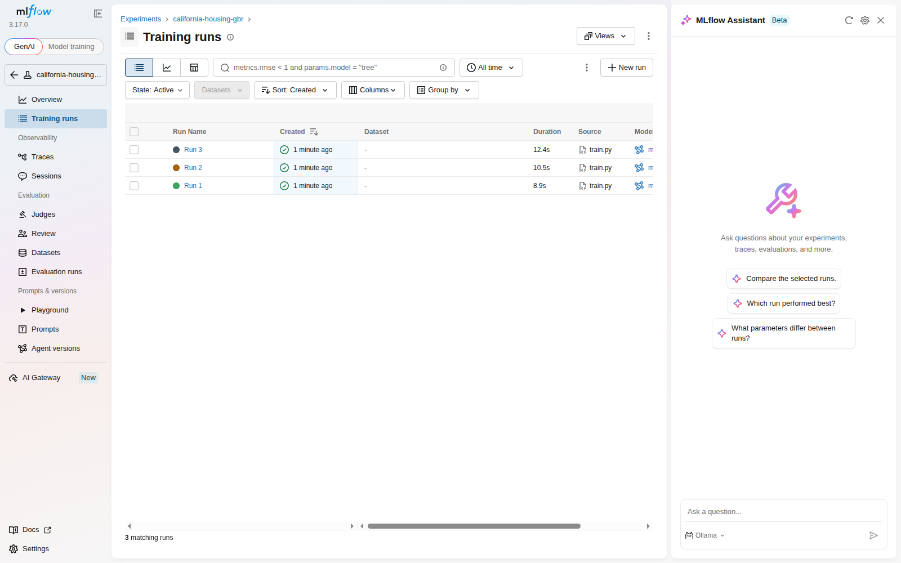

# ML Experiment Tracking with MLflow

This project trains the same `GradientBoostingRegressor` three times on the **California Housing** dataset using different `max_depth` and `learning_rate` values. Each experiment is tracked with MLflow, including its parameters, validation metrics, and trained model artifact.


## Dataset and split

- Dataset: California Housing (`sklearn.datasets.fetch_california_housing`)
- Training split: 80%
- Validation split: 20%
- Random seed: `42`
- Model: `GradientBoostingRegressor`
- Fixed model setting: `n_estimators=100`

## How to run

### 1. Create and activate a virtual environment

```bash
python -m venv .venv
source .venv/bin/activate       # Linux/macOS
# .venv\\Scripts\\activate    # Windows
```

### 2. Install dependencies

```bash
pip install -r requirements.txt
```

### 3. Run the experiments

```bash
python train.py
```

The script downloads the California Housing dataset if needed, creates the reproducible split, trains all three configurations, logs the parameters/metrics/models to MLflow, and prints the validation results.

### 4. Open the MLflow UI

In a second terminal, from the project directory, run:

```bash
mlflow ui --host 127.0.0.1 --port 5000
```

Open <http://127.0.0.1:5000> and select the `california-housing-gbr` experiment. The local MLflow database is created as `mlflow.db`, while logged artifacts are stored under `mlruns/`.

## Experiment configurations

| Run | Max depth | Learning rate |
|---|---:|---:|
| Run 1 | 3 | 0.10 |
| Run 2 | 5 | 0.05 |
| Run 3 | 7 | 0.01 |

## MLflow results

The following screenshot was captured from the MLflow **Training runs** page after executing `train.py`:



### Validation comparison

| Run | Max depth | Learning rate | RMSE | MAE | R² |
|---|---:|---:|---:|---:|---:|
| Run 1 | 3 | 0.10 | 0.5422 | 0.3716 | 0.7756 |
| **Run 2** | **5** | **0.05** | **0.5198** | **0.3531** | **0.7938** |
| Run 3 | 7 | 0.01 | 0.6973 | 0.5311 | 0.6290 |

## Selected best model

**Run 2** (`max_depth=5`, `learning_rate=0.05`) is the selected model.

It has the lowest validation **RMSE (0.5198)**, which is the primary selection metric required for this task. It also has the lowest MAE (0.3531) and the highest R² (0.7938), providing additional evidence that it generalizes best among the three tested configurations.

## Example console output

```text
Train: (16512, 8), Validation: (4128, 8)
Run 1: depth=3 lr=0.1 RMSE=0.5422 MAE=0.3716 R2=0.7756
Run 2: depth=5 lr=0.05 RMSE=0.5198 MAE=0.3531 R2=0.7938
Run 3: depth=7 lr=0.01 RMSE=0.6973 MAE=0.5311 R2=0.6290

Best model: Run 2 (max_depth=5, learning_rate=0.05, RMSE=0.5198)
```
